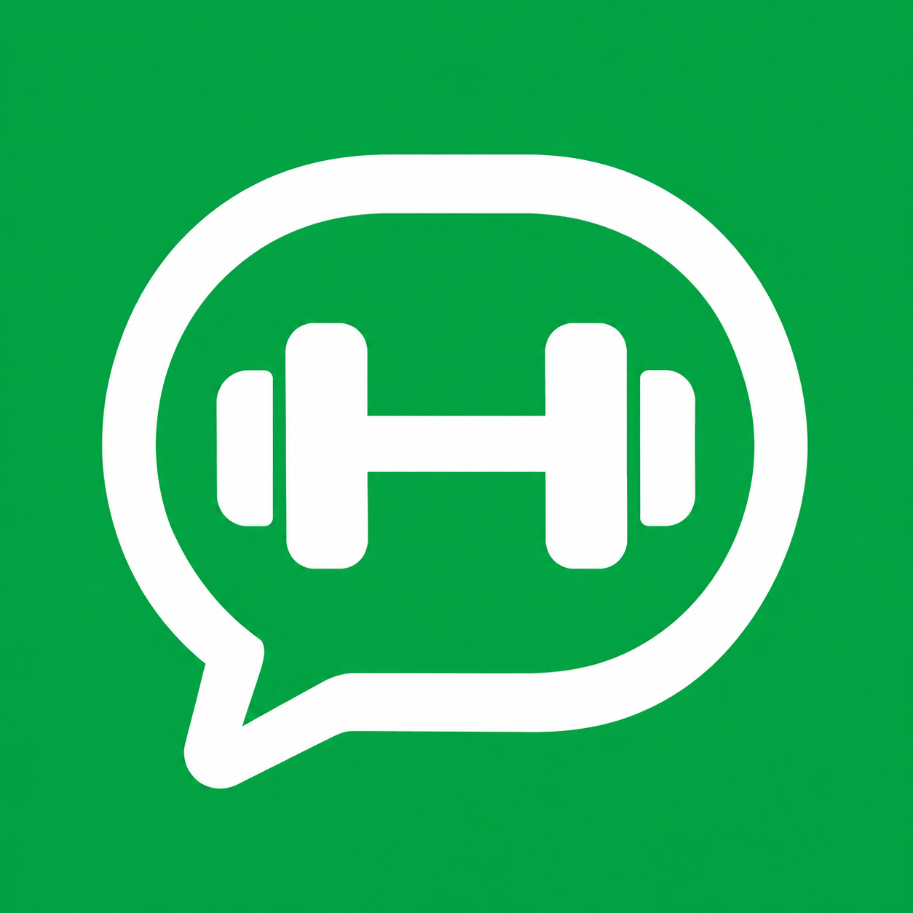

# Fitness Companion · 练得明白



一个用中文聊清楚训练、饮食、补剂和睡眠的 Agent Skill，采用MIT许可。

Fitness Companion is a Chinese-language fitness skill for adults, tailoring training, nutrition, supplement choices, and sleep guidance to your goals, schedule, and equipment. Supports exercise tutorials, on-demand feedback, and portable plans for continuing across chats.

[GitHub仓库](https://github.com/RuneYang123/fitness-companion) · [问题反馈](https://github.com/RuneYang123/fitness-companion/issues) · [联系作者](mailto:runeyang123@outlook.com)

<p align="center">
  
</p>

**说清你的目标和条件，拿到一份能执行的清单；遇到具体问题，再展开讲。**

适合成年人开始健身、减脂、增肌或兼顾两者。健身房和居家都可以，默认独自训练，没有教练陪同。计划按用户条件编排，不承诺固定时间内的体重或增肌幅度。

## 能做什么

| 你来问 | 它怎么帮你 |
|---|---|
| 一周只能练三天，怎么排？ | 结合基础、时间、器械与限制安排热身、主要动作、组次、休息和进阶 |
| 这个动作怎么做？ | 先给一句好理解的提示；追问时再展开具体设置、动作和自查点 |
| 只吃外卖，怎么吃？ | 按需求给食物和点餐组合；定量计划先列每日碳水、蛋白质、脂肪目标，再列每餐食品与份量 |
| 这顿饭合适吗？ | 宿主支持看图时，可粗看搭配和份量，说明隐藏油糖等不确定，不把照片当精确热量测量 |
| 要买哪些补剂？ | 分“必须、可选、特定情况再考虑”，允许没有必补项 |
| 最近睡不好 | 先简单问一句，再总结已知睡眠情况，给一两项调整 |
| 换个聊天或智能体，怎么接着用？ | 按需整理可复制的接续记录，保留具体计划与最近反馈；用户选择后可导出文件 |

**无热身不训练，无激活不训练。** 这里的激活是低疲劳的专项准备，不是练前再加一场训练。

动作教学直达视频优先使用已核对的谭成义本人B站内容；没有匹配片段时提供通用B站搜索入口，搜索不限教学者。文字提示照常保留，视频另起一行。项目独立维护，无教学者或机构官方背书。

## 安装

这是一个遵循 [Agent Skills 规范](https://agentskills.io/specification) 的 Skill，适用于支持 Agent Skills 的各类智能体。纯文本使用不需要 API 密钥、额外 Python 依赖、MCP 或定时任务；联网核验和照片反馈由智能体宿主能力决定。

### 方式一：让智能体直接安装（推荐）

直接复制下面这句话发给你的智能体：

```text
请帮我从 https://github.com/RuneYang123/fitness-companion 安装 fitness-companion 这个 Skill（将仓库中的 skills/fitness-companion 目录完整复制到你的 skills 目录中）。
```

### 方式二：手动安装

下载或克隆本仓库后，将 `skills/fitness-companion/` 整个文件夹（不要只复制单个 `SKILL.md`，需保留 `references/`、许可和来源声明等全部文件）复制到你所用智能体的 Skills 目录中即可（例如 `~/.agents/skills/fitness-companion` 或项目内的 `.agents/skills/fitness-companion`）。

## 开始使用

安装完成后，可以在对话中显式点名调用，也可以直接按自然语言提问：

```text
用 fitness-companion 帮我安排训练，先问最必要的信息。
```

常见问法示例：

- “我想兼顾增肌减脂，每周去健身房三次。”
- “今天只有半小时，帮我调整原来的训练。”
- “我只点外卖，先给建议，再列能选的食物。”
- “上斜哑铃卧推怎么做？”
- “我最近入睡有点慢，先简单问我一下作息。”

不想看完整计划时，直接说“只看今天”或“只讲这个动作”。

需要换聊天窗口或换其他智能体接着用时，直接说**“帮我整理一份接续记录”**，再把生成的记录发到新聊天中即可无缝继续，不用重新制定计划。

## 数据、来源和使用边界

- 本地封装目录不包含任何真实用户健康资料、私人付费计划、餐照、训练记录或本地视频缓存。
- Skill不会主动创建个人档案或自动提醒。主动写入、导出健康记录前应征求用户选择；聊天平台自身如何保存内容，取决于平台设置，Skill不能替平台承诺。
- 没有内置动作数据API，也尚未接入 exercises-dataset。参考资料里的原站链接和证据，不等于已获得第三方媒体再分发许可。
- 23份具体动作教学（含18项已核对的本人B站直达片段与5项通用基础动作卡）、35条B站来源的整理采用机器转写与关键画面对照，非逐字人工听审，也非专业动作评审；逐条来源与取舍记录见[来源与教学审计说明](docs/sources/source-audit.md)。搜索入口不计为已核对视频。
- 它帮助制定与讨论日常安排，不诊断疾病、不代替现场保护或医疗治疗。特殊人群、异常症状和治疗性补充需另行处理。

来源与许可边界见 [NOTICE](NOTICE.md)。项目原创说明与工具采用 [MIT](LICENSE)，第三方视频、图片、论文及其原文不在本项目许可授予范围内。

## 本地校验与封装

```sh
python3 scripts/package.py --check
python3 scripts/package.py --check --release
python3 -m unittest discover -s tests -v
python3 scripts/package.py
python3 scripts/package.py --repository
```

检查和测试只使用Python标准库。`--release`额外检查公开文档中的联系占位符和仓库信息；默认封装只生成独立Skill包，`--repository`同时生成干净仓库包。两种包都带完整性核对，校验值写入`dist/SHA256SUMS.txt`；脚本不执行Git提交、上传或全局安装。

| 文件 | 用途 |
|---|---|
| `dist/fitness-companion-skill-v0.1.0.zip` | 安装用，包含完整Skill目录和文件哈希清单 |
| `dist/fitness-companion-repository-v0.1.0.zip` | 仓库用，包含README、许可、贡献说明、GitHub模板、校验工具和Skill源码 |

封装仅读取本项目白名单文件，不包含上层工作区、私人方案、训练记录、视频缓存、宣传稿或本地维护记录。安装时保留整个Skill目录；准备上传时使用仓库包中的内容，勿把私人健身工作区整体上传。

贡献方式见[贡献说明](CONTRIBUTING.md)，首次上传和GitHub设置见[发布说明](docs/publishing.md)，版本内容见[更新记录](CHANGELOG.md)。结尾中的仓库地址和联系邮箱已填写；发布前仍需确认仓库公开可访问，且“已经开源发布”与实际状态一致。
