<div align="center">


# Fitness Companion · 练得明白

**一个真正懂独自训练、懂中餐外卖、拒绝瞎编链接的中文健身 Agent Skill**

*A modular Chinese-language fitness skill for AI agents — tailoring training, practical nutrition, evidence-based supplements, and sleep recovery to your real life.*

<p>
  <a href="https://agentskills.io/specification"></a>
  <a href="CHANGELOG.md"></a>
  <a href="skills/fitness-companion/references/teaching-index.md"></a>
  <a href="LICENSE"></a>
  <a href="https://github.com/RuneYang123/fitness-companion/issues"></a>
</p>

<p>
  <a href="#-30-秒极速安装">30 秒安装</a> ·
  <a href="#-为什么做它">为什么做它</a> ·
  <a href="#-四大核心模块">核心模块</a> ·
  <a href="#-真实输出预览">效果预览</a> ·
  <a href="https://github.com/RuneYang123/fitness-companion/issues">问题反馈</a> ·
  <a href="mailto:runeyang123@outlook.com">联系作者</a>
</p>



</div>

---

## 💡 为什么做它？

刚开始健身或想靠 AI 排计划时，绝大多数人都会卡在这两件事上：
1. **收藏夹里的碎片干货，拼不出一个完整的你**：今天存个练肩秘籍、明天看个练背邪修，到了健身房还是不知道今天先练哪块、做几组。
2. **普通 AI 问答太像“纸上谈兵的教科书”**：一问就一口气吐出三千字长文，默认你有人保护、天天能自己水煮鸡胸肉，甚至还会瞎编根本点不开的教学视频链接。

**`Fitness Companion · 练得明白` 把 AI 改造成了一个讲人话、守边界的健身搭子：**

| 常见痛点 | 普通 AI 健身问答 | Fitness Companion · 练得明白 |
|---|---|---|
| **交互节奏** | 不管你看不看得完，一次甩出训练+饮食+补剂三千字长文 | **单模块渐进推进**：先摸底，每次只聊透一块，聊完再由你决定下一步看什么 |
| **训练场景** | 动不动写“请教练辅助保护”“注意标准姿势”等空话 | **默认独自训练**：直接写清座椅调到哪一格、安全限位怎么挂、做不动怎么退阶 |
| **动作教学** | 经常幻觉编造失效链接，或只有干巴巴的文字描述 | **真伪严格分界**：内置 23 张动作卡，18 项核对到秒的**谭成义 B 站原片直达**，无匹配片段老实给 B 站搜索 |
| **饮食落地** | 默认人人都有厨房和食物秤，顿顿水煮鸡胸配西蓝花 | **中餐与外卖友好**：懂沙县、麻辣烫、小碗菜；内置**生米熟饭/带骨鸡腿净肉/外卖隐形油换算锚点**，支持看餐照粗评 |
| **补剂推荐** | 一问就罗列七八种补剂清单，恨不得让你全买齐 | **三层克制做减法**：按“必须 / 可选 / 特定情况”划分，允许**“目前没有必补项”**直接帮你省钱 |
| **执行弹性** | 预设死板日历与每日打卡，漏练一次全盘打乱 | **无打卡焦虑 + 随时应变**：加班只剩 30 分钟？器械被占？一句话帮你改成当天的保底安排 |

---

## 🚀 30 秒极速安装

这是一个遵循 [Agent Skills 规范](https://agentskills.io/specification) 的纯文件型 Skill，适用于所有支持 Agent Skills 的智能体（Claude Code、Codex、Cursor、DeepSeek Harness、Antigravity 等）。**零 API 密钥依赖、零额外 Python 第三方库、无需配置定时任务。**

### 方式一：让智能体自动安装（推荐）

直接复制下面这句话发给你的智能体，它会自动拉取并放到对应的 Skills 目录中：

```text
请帮我从 https://github.com/RuneYang123/fitness-companion 安装 fitness-companion 这个 Skill（将仓库中的 skills/fitness-companion 目录完整复制到你的 skills 目录中）。
```

<details>
<summary><b>方式二：手动命令行安装（点击展开）</b></summary>

<br>

将仓库中的 `skills/fitness-companion/` **整个文件夹**（需完整保留 `SKILL.md`、`references/`、`LICENSE` 和 `NOTICE.md`）复制到你所用智能体的 Skills 目录即可：

```sh
git clone https://github.com/RuneYang123/fitness-companion.git
mkdir -p ~/.agents/skills
cp -R fitness-companion/skills/fitness-companion ~/.agents/skills/
```

项目级使用也可复制到目标工作区的 `.agents/skills/fitness-companion/`。

</details>

---

## 💬 开始使用

装好之后，你可以显式点名调用，也可以直接用最自然的大白话开聊：

```text
用 fitness-companion 帮我安排训练，先问最必要的信息。
```

### 高频对话场景

| 你在什么场景 | 你可以直接这么跟它说 | 它会怎么接招 |
|---|---|---|
| 🆕 **从零定制计划** | `“我想兼顾增肌减脂，每周去健身房三次，帮我排个计划。”` | 分两轮轻量摸底目标、身体条件、时间与伤病限制，再从训练模块开始一步步盘 |
| ⏱️ **临时加班应变** | `“今天加班只有半小时，帮我把原来的训练砍成保底版。”` | 保留热身激活与前两项核心复合动作，不让你把漏练硬挤到第二天 |
| 🎯 **动作找发力感** | `“坐姿划船老是只有胳膊酸、背没感觉，怎么调？”` | 按需调取对应动作卡，讲清座椅设置、肩肘轨迹，并给**一个**下一组就能试的小办法 |
| 🍱 **外卖党怎么吃** | `“我天天只能点外卖，怎么吃？顺便给我每顿具体份量。”` | 给沙县/小碗菜/麻辣烫实操点法；定量计划先列全天碳水/蛋白/脂肪目标，再列分餐生熟重 |
| 📸 **拍盒饭看搭配** | *(发一张午饭照片)* `“帮我看看这顿外卖怎么样？”` | 宿主支持看图时，粗看主食、蛋白、蔬菜比例并给一条微调建议，不冒充精确热量计 |
| 🔄 **换聊天接着用** | `“帮我整理一份接续记录，我换个新窗口接着用。”` | 生成带完整当前计划、最新负荷与待确认项的 Markdown 接续记录，发到新会话直接无缝继续 |

---

## 🧩 四大核心模块

### 1. 🏋️ 训练编排与 23 张动作教学卡
- **铁律提示**：**“无热身不训练，无激活不训练。”** 每份训练表必带具体关节活动与次数；表内第 1 项固定为低疲劳专项激活（不计正式组、不练到力竭），第 2、3、4 项优先排核心复合动作。
- **双层动作卡机制**：日常清单只给“一句关键提示 + 视频/搜索入口”，追问时才展开详细器械调节、呼吸、自查点与排错试法。
- **视频真伪零妥协**：动作教学直达视频优先采用逐帧核对过的谭成义本人 B 站原片（带精确起止时间）；尚无匹配直达片段的动作统一提供 `B站搜索｜具体动作名动作教学`，绝不混用或伪造链接。

### 2. 🍱 中餐与外卖友好的饮食规划
- **生活份量优先**：默认用“几碗、几掌、几拳、几盒”沟通，不强迫新手先买厨房秤。
- **中餐生熟重速查锚点**：需要定量饮食时，内置生米 ↔ 熟米饭、干面 ↔ 熟面、生熟净肉失水率、带骨整鸡腿去骨净肉率及外卖隐形烹调油参考，拒绝生熟混算。
- **健康的饮食心态**：不列普通食物的永久禁食表，不设“放纵日”或“吃多了挨饿加练赎罪”。

### 3. 💊 三层克制补剂评估
- 按人划分为 **“必须 / 可选 / 特定情况再考虑”** 三层，明确允许**“必须项：目前没有明确必补项”**。
- 先看三餐实际缺口与产品营养成分表（区分蛋白粉总重与纯蛋白克数、鱼油总重与 EPA+DHA、镁盐与元素镁），日常服用表只留真正需要的极少数项目。

### 4. 🌙 睡眠与恢复
- 独立入口，不把睡不好直接当成“缺某种补剂”。
- 首次只问一句 *“最近睡得怎么样？一般几点睡、几点起？”*，先区分“躺床上的睡眠窗口”与“实际睡眠时长”，再针对晚间咖啡因、晚练兴奋或作息节律给 1～2 项能立刻试的调整。

---

## 👀 真实输出预览

<details>
<summary><b>点击展开：看看它生成的训练表、定量饮食与补剂评估长什么样</b></summary>

<br>

#### 1. 训练清单片段（每周三练 A/B 起步示例）
> **无热身不训练，无激活不训练。**
> - **关节活动**：手臂前后绕环各 8 次、屈伸手肘 8 次、扶稳踝关节前移每侧 8 次、徒手深蹲与徒手髋铰链各 8 次。
>
> | 顺序 | 动作 | 组次 | 一句提醒 |
> |---|---|---|---|
> | 1．激活准备 | 轻重量腿举 | 8次，稍加重量5次 | 背和臀贴稳靠垫，先找好范围，不练累 |
> | 2．主要训练 | 器械腿举<br>[B站搜索｜器械腿举动作教学](https://search.bilibili.com/all?keyword=%E5%99%A8%E6%A2%B0%E8%85%BF%E4%B8%BE%20%E5%8A%A8%E4%BD%9C%E6%95%99%E5%AD%A6) | 2×10～12 | 膝盖顺着脚尖方向走，下放时腰臀别卷离靠垫 |
> | 3．主要训练 | 胸托坐姿器械划船（对握）<br>[谭成义视频｜B站教学（7:29起）](https://www.bilibili.com/video/BV1CAaR6rECN/?t=449) | 2×10～12 | 胸贴稳支撑，手肘向后走，别挺腰拉重量 |
> | 4．主要训练 | 上斜哑铃卧推<br>[谭成义视频｜B站教学（12:25起）](https://www.bilibili.com/video/BV1fa6CBDEEu/?t=745) | 2×8～12 | 两边一起慢慢落，别抬头、别扭腰 |

#### 2. 补剂三层评估片段
> - **必须**：**目前没有明确必补项。** 普通健身先把三餐主食和肉蛋奶吃稳，不需要先买一堆瓶瓶罐罐。
> - **可选**：
>   - **乳清蛋白粉**：只有当天外卖肉确实没吃够时，用 1 勺补足缺口；吃够了就不用喝。
>   - **单水肌酸**：如果准备长期规律练力量，可考虑每天 3～5g（无需冲击期）。
> - **特定情况再考虑**：长期几乎不晒太阳再看**维生素 D**；几乎不吃鱼再看**鱼油**。

</details>

---

## 🛡️ 数据隐私、来源边界与本地校验

- **零隐私夹带**：公开仓库与安装包由 `scripts/package.py` 白名单严格校验，不含任何真实用户健康档案、私人方案、餐照或训练记录。Skill 不会在后台自动建档或设提醒；导出接续记录前必先征得用户同意。
- **来源与版权声明**：23 份动作教学与 35 条 B 站来源整理基于机器转写与关键画面抽帧核对（非逐字人工听审，详见 [来源与教学审计说明](docs/sources/source-audit.md)）。项目独立维护，无任何教练或机构官方背书。原创说明与代码采用 [MIT 许可](LICENSE)，第三方视频、图片与文献原文权利归原作者所有，详见 [NOTICE](NOTICE.md)。
- **医疗免责边界**：本 Skill 仅提供普通成年人日常健身与饮食参考，不诊断疾病、不开具医疗或康复处方、不替代现场保护。

<details>
<summary><b>开发者：本地校验与打包命令（点击展开）</b></summary>

<br>

本项目校验与打包仅使用 Python 标准库：

```sh
python3 scripts/package.py --check --release
python3 -m unittest discover -s tests -v
python3 scripts/package.py --repository
```

| 构建产物 | 用途 |
|---|---|
| `dist/fitness-companion-skill-v0.1.0.zip` | 独立 Skill 安装包（仅含运行时 `skills/fitness-companion/` 与 `MANIFEST.json` 哈希清单） |
| `dist/fitness-companion-repository-v0.1.0.zip` | 完整干净仓库包（含 README、源码、溯源文档、校验脚本与 GitHub 工作流） |

贡献指南见 [CONTRIBUTING.md](CONTRIBUTING.md)，发布流程见 [发布说明](docs/publishing.md)，版本历史见 [CHANGELOG.md](CHANGELOG.md)。

</details>

---

<div align="center">

**“如果你问我，最佳的锻炼年份和月份是什么时候？答案永远只有一个：就是现在。”**

如果这个项目帮到了你，欢迎点一个 ⭐ **Star**，或通过 [GitHub Issues](https://github.com/RuneYang123/fitness-companion/issues) 与 [runeyang123@outlook.com](mailto:runeyang123@outlook.com) 交流你的训练心得。

</div>
